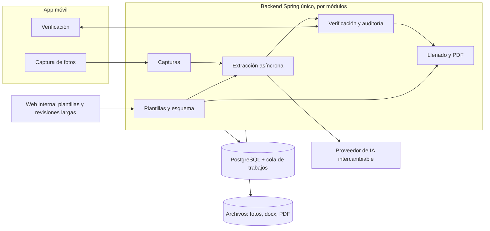
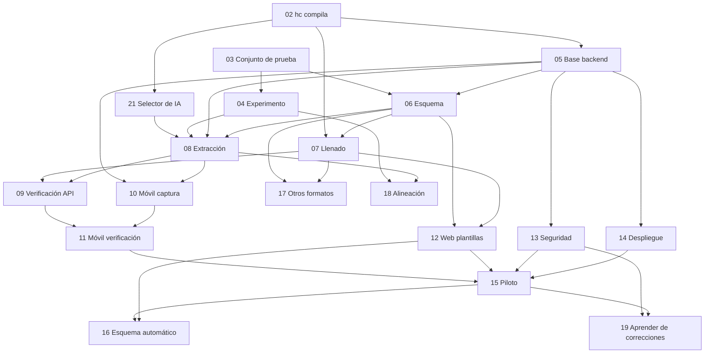

# Pendientes — Producto de historias clínicas (HC)

**Qué es el producto:** el personal de salud toma fotos de historias clínicas en papel. La IA lee los datos guiándose por la plantilla de la clínica. Una persona verifica cada campo en el móvil. Al final se genera el documento llenado en el formato original de la clínica (Word primero, después otros formatos).

**Origen:** análisis del repositorio del 2026-11-16 (rama `hc-digitalizacion-3`).

**Rutas de código:** salvo que se indique otra cosa, son relativas a `backend-clinica/hc/src/main/java/com/historias_clinicas/hc/`. Los números de línea vienen de ese análisis; verifícalos antes de empezar cada tarea.

## Arquitectura objetivo

## Orden sugerido

| # | Tarea | Fase | Complejidad | Depende de |
|---|---|---|---|---|
| 01 | [Sacar las claves del repositorio](01-claves-fuera-del-repo.md) — **en espera** por decisión tuya | 0 · Base estable | Mediana | — |
| 21 | [Elegir el proveedor de IA desde el front](21-selector-proveedor-ia.md) | 0 · Base estable | Mediana | 02 |
| 03 | [Conjunto de prueba (plantilla + fotos + respuestas)](03-dataset-de-prueba.md) | 1 · Validar lectura | Mediana | Cliente |
| 04 | [Experimento de lectura de fotos](04-experimento-lectura.md) | 1 · Validar lectura | Mediana | 03 |
| 05 | [Base del backend del producto](05-base-backend-hc.md) | 2 · Núcleo backend | Compleja | 02 |
| 06 | [Esquema de campos de las plantillas](06-esquema-de-plantillas.md) | 2 · Núcleo backend | Mediana | 03, 05 |
| 07 | [Llenado con marcadores (sin IA)](07-llenado-con-marcadores.md) | 2 · Núcleo backend | Compleja | 02, 06 |
| 08 | [Extracción desde fotos](08-extraccion-desde-fotos.md) | 2 · Núcleo backend | Compleja | 04, 05, 06 |
| 09 | [Verificación y auditoría (API)](09-verificacion-y-auditoria.md) | 2 · Núcleo backend | Mediana | 07, 08 |
| 10 | [App móvil: captura](10-app-movil-captura.md) | 3 · Aplicaciones | Compleja | 05, 08 |
| 11 | [App móvil: verificación](11-app-movil-verificacion.md) | 3 · Aplicaciones | Compleja | 09, 10 |
| 12 | [Web interna de plantillas](12-web-interna-plantillas.md) | 3 · Aplicaciones | Mediana | 06, 07 |
| 13 | [Seguridad y privacidad](13-seguridad-y-privacidad.md) | 4 · Piloto | Compleja | 05 |
| 14 | [Despliegue](14-despliegue.md) | 4 · Piloto | Mediana | 05 |
| 15 | [Piloto con una clínica](15-piloto-con-clinica.md) | 4 · Piloto | Mediana | 09–14 |
| 16 | [Propuesta automática de esquema con IA](16-propuesta-automatica-de-esquema.md) | 5 · Crecer | Compleja | 12, 15 |
| 17 | [Otros formatos de plantilla (PDF)](17-otros-formatos.md) | 5 · Crecer | Compleja | 06, 07 |
| 18 | [Alineación cuando la foto es del mismo formato](18-alineacion-mismo-formato.md) | 5 · Crecer | Compleja | 04, 08 |
| 19 | [Aprender de las correcciones](19-aprendizaje-de-correcciones.md) | 5 · Crecer | Mediana | 13, 15 |
| 20 | [Horario-Service no compila (codificación)](20-horario-service-codificacion.md) | Fuera del producto HC | Simple | — |

La tarea 02 ya está en curso: ver [`../tareas/`](../tareas/README.md).

### Dependencias

**Se puede avanzar en paralelo:**
- La tarea 03 depende del cliente: pídele el material el primer día, mientras haces 02 y 21.
- Las tareas 13 y 14 pueden avanzar durante la fase 3.

## Estimación gruesa (1 desarrollador)

| Fase | Tareas | Duración estimada |
|---|---|---|
| 0 · Base estable | 01–02 | 3–5 días |
| 1 · Validar lectura | 03–04 | 1–2 semanas (depende de cuándo lleguen las fotos) |
| 2 · Núcleo backend | 05–09 | 5–7 semanas |
| 3 · Aplicaciones | 10–12 | 5–7 semanas |
| 4 · Piloto | 13–15 | 2–3 semanas de preparación + 2–4 semanas de piloto |
| 5 · Crecer | 16–19 | Según los resultados del piloto |

Son unos 4 meses hasta empezar el piloto. **Hay que recalcular al terminar la fase 1:** si la lectura de fotos no alcanza la precisión acordada, cambian las fases 2 a 5.

## Decisiones tomadas

- **Un solo backend por módulos** para el producto HC, no microservicios. Citas, horarios y el chat de IA quedan fuera del producto.
- **Se congela `PlantillaProcessorService`** (las heurísticas para detectar campos). No se le agregan reglas; queda como referencia hasta la tarea 16.
- **El esquema de campos lo confirma una persona y se versiona.** El llenado del Word se hace con marcadores y sin IA.
- **Primero se valida la lectura de fotos**, porque es el mayor riesgo. El esquema de las primeras plantillas se escribe a mano.
- **2026-11-16:** por ahora las claves no se mueven del repositorio (tarea 01 en espera). El proveedor de IA se podrá elegir desde el front (tarea 21).
- **Se reutiliza el patrón de IDs estables:** la IA solo puede elegir elementos que existen, y después se valida su respuesta. Aplica tanto a las celdas de la plantilla como a las palabras de la foto.

## Pendientes con el cliente

| # | Qué se necesita | Para qué tarea | Estado |
|---|---|---|---|
| 1 | Una plantilla real de HC en Word (la más usada) | 03 | ⏳ |
| 2 | 30–50 fotos de HC llenadas, con permiso de uso. Lo ideal es que el personal las llene a mano con datos ficticios | 03 | ⏳ |
| 3 | Los valores correctos de esas HC, o alguien que valide la transcripción | 03 | ⏳ |
| 4 | La precisión mínima aceptable y cuánto tarda hoy transcribir una HC a mano | 04, 15 | ⏳ |
| 5 | Si las fotos serán del mismo formato que la plantilla o de otros formatos | 08, 18 | ⏳ |
| 6 | Quiénes usarán la app (roles), qué teléfonos (Android/iOS) y cómo es la conectividad en planta | 10, 11, 13 | ⏳ |
| 7 | Requisitos legales e institucionales sobre los datos de pacientes | 13 | ⏳ |
| 8 | Clínica, usuarios y fechas para el piloto | 15 | ⏳ |

## Pendientes tuyos (fuera del código)

- Tarea 01 en espera por decisión tuya. Las claves siguen en GitHub; conviene rotarlas antes del piloto con datos reales.
- Crear cuentas de prueba en los proveedores de IA y OCR que se van a comparar (tarea 04).

## Fuera del producto HC (sin ficha por ahora)

Si se retoma el sistema de citas, convertir estos puntos en fichas:
- `Automatizacion-Service` tiene `security.disabled=true`, así que todos sus endpoints están abiertos.
- El usuario de sistema de la IA usa la contraseña `1234` por defecto (`SystemAuthService`).
- El monolito `backend-clinica/backend-clinica` (puerto 8080) duplica los microservicios.
- Las URLs `localhost:puerto` están fijas en los clientes Feign y en el frontend.

---

Cuando una tarea empieza, su ficha se mueve a `tareas/NN-nombre/` y sale de este índice.
