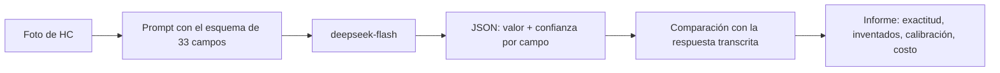

# Tarea 04 — Experimento de lectura de fotos: flujo

**El flujo del producto no cambia.** El experimento es un script aparte (`experimentos/lectura-fotos/leer_fotos.py`) que no toca los servicios. Sirve para decidir con datos si la lectura de fotos es viable antes de construir la extracción (tarea 08).

**Cambios respecto a la ficha:**
- **Solo DeepSeek**, por decisión tuya: GPT queda fuera. Claude y Gemini no se probaron porque no hay claves.
- **Modelo:** `deepseek-flash`, el único de la cuenta que lee imágenes. `deepseek-v4-pro` acepta la petición pero **descarta la imagen sin avisar** y devuelve todo en null.
- **Solo se probó la opción E1** (modelo con visión). La E2 (OCR con coordenadas) necesita cuentas de Azure o Google que no hay.
- **Variantes:** v1 manda la foto completa. v2 manda la foto completa más sus dos mitades ampliadas, porque el servicio reduce cada imagen a unos 1300 px por lado.

**Impacto:**

| Área | Impacto | Acción necesaria |
|---|---|---|
| Código del producto | No aplica | — |
| Seguridad y datos personales | Las fotos (de internet, con datos reales) se enviaron a DeepSeek | Para fotos de una clínica real hará falta un proveedor con acuerdo para datos de salud (tarea 13) |
| Claves | La clave de DeepSeek del repo ya no sirve (401). Se usó una clave de prueba tuya, leída de un archivo fuera del repositorio | El script lee `DEEPSEEK_API_KEY` o `DEEPSEEK_API_KEY_FILE`. No se guarda en git |
| Costo | La cuenta tenía USD 1.50 de saldo | El script mide el costo por diferencia de saldo |
